# Proof-of-Work OS

**An automata-based evidence verification system for developer skills.**

Live deployment: https://proof-of-work-os.onrender.com

## Problem

Skill lists and task trackers are self-reported: anyone can tick "Completed" or write "I know Flask". Recruiters cannot tell claim from proof.
Proof-of-Work OS makes a claim count only after it passes a **controlled verification lifecycle**: the developer attaches evidence, a *different* person reviews it, and every step is recorded in a tamper-evident log. The lifecycle is enforced by a finite-state machine, not by convention.

## Features

- Accounts with hashed passwords, CSRF protection, per-user data isolation
- Projects and tasks (create / view / edit / delete); every task gets one workflow
- **Finite-state machine** governing `CREATED → IN_PROGRESS → EVIDENCE_REQUIRED → EVIDENCE_SUBMITTED → VALIDATING → VERIFIED / REJECTED` (+ `RESTART` after rejection)
- Evidence submission (repo, commit, PR, deployment, demo, write-up, other link) with strict validation; evidence is locked once submitted
- **Two separate account types, chosen at sign-up and sign-in** (landing page: *I'm a Developer* / *I'm a Reviewer*). Developers manage tasks and evidence; reviewers have their own page. Neither can use the other's area.
- **Multi-reviewer verification.** The developer sends evidence to 1-5 distinct reviewers and chooses how many must approve (default 2; policies such as 1 of 1, 2 of 2, 2 of 3). Each reviewer records their own approve/reject with a written note. Nobody can review their own work, and reviewers cannot see each other's decisions until they have decided (independence).
- **Approval policy is sealed** into the audit chain at submission. Verified when the required number approve; rejected as soon as that number can no longer be reached. Reviewers can be replaced while unavailable; changing evidence means *withdrawing* the submission, which starts a new round (old decisions stay in history but no longer count).
- **Open reviewer registration and discovery.** Anyone can register as a Developer or a Reviewer (roles stay separate and are never changeable through a request). Reviewers build a profile (display name, headline, bio, skills, expertise, experience level, work history, education, links) with a visibility setting: *private* (default), *unlisted* (public page by link) or *listed* (directory). Optional blocks can be hidden individually. Developers search the **reviewer directory** by name, skill, expertise and experience level (server-side filtering and pagination, 10 per page) and pick reviewers in a **picker** during evidence preparation; the backend re-validates every selected id (real reviewer account, listed, distinct, not the owner, 1 <= k <= n <= 5).
- **Trust labelling.** All profile content is labelled *self-reported*; nothing is marked verified because no verification process exists. The only platform-derived facts are the account creation date and the number of review decisions recorded in `review_decisions` (counts only; submission titles and evidence are never shown). There are no ratings, endorsements or reputation scores.
- **Shareable verified proof**: after verification, the developer can create a public read-only link (and `/u/<username>` profile). It shows approvals vs. required vs. assigned, reviewer usernames and decisions, dates, an evidence-version fingerprint, public-flagged notes and a live integrity check, plus a notice that independent reviewer approval is *not* organisation certification. Links can be revoked (HTTP 410, nothing shown); re-sharing issues a new token. Unverified or rejected proofs are never shown as verified.
- **Standout feature — tamper-evident audit trail + live automaton view** (below)
- Reviewer aid: transparent evidence *completeness* checklist (not automated verification)
- Safe, repeatable schema migrations that preserve existing data

## Standout feature: hash-chained audit trail replayed through the automaton

Every successful transition is appended to `state_transitions` with `hash = SHA-256(fields + prev_hash)`, so each entry commits to all earlier ones. On every task page the app **verifies the chain and replays the recorded events through the automaton**. History is accepted only if:

1. every hash and link matches (no edited, removed or reordered records),
2. every step is an edge of the transition table (the event word is accepted by the DFA),
3. the replayed end state equals the state stored on the workflow,
4. the evidence that was submitted still matches the digest sealed at submission time.

The page also draws the automaton as SVG from the real transition table: current state, transitions already taken, transitions you can fire now, and transitions waiting on another role. Refused actions (invalid transition, wrong role, failed guard) are logged and shown under *Blocked attempts*; a "Demo" panel lets you try a forbidden event on purpose.

**Limits (say this in interviews):** it is tamper-*evident*, not tamper-proof. Someone with full write access to the SQLite file can recompute the whole chain. Anchoring `chain_head` externally would close that gap. Updates are also blocked at DB level by triggers, but a DB admin can drop triggers.

## The automaton

Formally a DFA `M = (Q, Σ, δ, q0, F)`:

- **Q** = 7 states, **Σ** = 11 events (`automata/states.py`)
- **δ** = a *partial* transition function (`automata/transitions.py`); undefined (state, event) pairs are rejected
- **q0** = `CREATED`, **F** = `{VERIFIED}`; `VERIFIED` is terminal

```mermaid
stateDiagram-v2
    [*] --> CREATED
    CREATED --> IN_PROGRESS: START (owner)
    IN_PROGRESS --> EVIDENCE_REQUIRED: REQUEST_EVIDENCE (owner)
    EVIDENCE_REQUIRED --> EVIDENCE_SUBMITTED: SUBMIT_EVIDENCE (owner; evidence + reviewers; seals policy)
    EVIDENCE_SUBMITTED --> VALIDATING: START_VALIDATION (assigned reviewer)
    EVIDENCE_SUBMITTED --> EVIDENCE_SUBMITTED: REASSIGN_REVIEWER (owner)
    VALIDATING --> VALIDATING: VOTE_APPROVE / VOTE_REJECT (assigned reviewer, once each)
    VALIDATING --> VALIDATING: REASSIGN_REVIEWER (owner)
    VALIDATING --> VERIFIED: APPROVE (system: approvals >= required)
    VALIDATING --> REJECTED: REJECT (system: approval no longer possible)
    EVIDENCE_SUBMITTED --> IN_PROGRESS: WITHDRAW (owner, new round)
    VALIDATING --> IN_PROGRESS: WITHDRAW (owner, new round)
    REJECTED --> IN_PROGRESS: RESTART (owner, new round)
    VERIFIED --> [*]
```



Beyond δ, the engine checks, in order: event exists → δ defined (else `INVALID_TRANSITION`) → actor allowed (`UNAUTHORIZED_ACTOR`; role read from DB; a reviewer must be assigned to *this* round; the owner can never review own work) → guards (`GUARD_FAILED`: evidence present, 1 ≤ k ≤ n reviewers, note 5-2000 chars, one decision per reviewer; `EVIDENCE_CHANGED`: evidence digest differs from the sealed one) → atomic write. Every refusal is logged to `blocked_actions`.

**Approval policy.** Votes are self-loops in `VALIDATING`. After each vote the engine, in the same transaction, fires `APPROVE` (system actor) if approvals ≥ k, or `REJECT` if rejections > n − k (approval impossible; with k = n a single rejection rejects). `APPROVE`/`REJECT` can never be fired by a person. The policy `{reviewers, required}` is stored in the hashed `meta` of the `SUBMIT_EVIDENCE` link, so it cannot be changed afterwards without breaking the chain, and `verify_chain` re-checks quorum, voter eligibility, duplicate votes and that `review_decisions` matches the chain.

**Races.** Transitions run in `BEGIN IMMEDIATE` with compare-and-swap on state and transition count; concurrent identical votes or events advance exactly once.

**Change from the earlier version:** `VERIFIED → RESTART` was removed so a verified proof cannot be silently re-opened.

## Architecture

| Path | Responsibility |
|---|---|
| `automata/` | Pure FSM: states, events, δ, role requirements. No DB/Flask |
| `services/automata_engine.py` | Transactional engine: checks, atomic state + history + side effects |
| `services/integrity.py` | Hash chain, evidence digest, chain verification/replay |
| `services/evidence_service.py` | Evidence validation, storage, completeness checklist |
| `services/fsm_view.py` | View-model for the SVG diagram (from real data) |
| `routes/` | Flask blueprints: auth, main/dashboard, tasks, projects |
| `database/` | `schema.sql` (original baseline), `migrations.py`, connection + `transaction()` |
| `templates/`, `static/` | Jinja UI |
| `tests/` | pytest suite |

Atomicity: each transition runs in `BEGIN IMMEDIATE`; state update is a compare-and-swap on the old state and count; the history insert, state update, verification records and task update commit together or roll back together.

## Database

Existing tables are kept. Migration 1 (tracked via `PRAGMA user_version`) adds: `users.role`; `workflow_instances.round/chain_head/transition_count`; chain columns on `state_transitions`; `evidence.workflow_id/round`; table `blocked_actions`; indexes (one workflow per task, unique `(workflow_id, seq)`); append-only triggers. Tasks lacking a workflow get one (replacing the old create-on-dashboard-load behaviour). Pre-existing transitions are sealed into the chain and marked `actor_role='legacy'`. Nothing is dropped or deleted.

Migration 2 adds `workflow_instances.reviewer_id` (who the evidence was sent to) and `share_token` (public link; unique, null = private).

Migration 4 (reviewer profiles) reuses the existing `profiles` table (display name = `full_name`, headline, bio, links, `profile_visibility`) and adds nullable/defaulted columns (`experience_level`, `work_history`, `education`, `github_url`, `pub_*` flags, `updated_at`), the table `reviewer_tags` (skills and expertise, indexed for SQL filtering) and a private profile row for each existing reviewer. Nothing is dropped, and no existing reviewer becomes listed until they choose to.

Migration 3 (multi-reviewer) adds `review_assignments` (per workflow/round/reviewer; `assigned` or `cancelled`, never deleted), `review_decisions` (one row per reviewer per round: decision, shared note, private note, public flag, evidence digest, timestamp; append-only triggers), `state_transitions.meta`, `workflow_instances.required_approvals` and `share_revoked_at`. Existing single-reviewer assignments become assignments; **no historical decisions are fabricated**: old proofs keep their original chain (verified by a test using a real v2 database) and the public page derives the old reviewer's decision from that chain.

Upgrade: just start the app or run `flask --app app init-db`. Safe to repeat. Back up your `.db` first as good practice.

`tasks.status` (Pending/Completed) is the owner's **self-reported** progress. The **workflow state** is the verified truth. Approval also sets status to Completed.

## Run locally

```bash
python -m venv venv && source venv/bin/activate   # Windows: venv\Scripts\activate
pip install -r requirements-dev.txt
export REVIEWER_EMAILS=reviewer@example.com        # optional; see below
python app.py                                       # http://127.0.0.1:5000
```

Open `http://127.0.0.1:5000/` and choose **Developer** or **Reviewer**. The role is fixed at sign-up and checked at every sign-in. Reviewer sign-up is open to everyone; there is no invitation code or allowlist any more. `flask --app app set-role someone@example.com reviewer` changes an existing account.

### Demo script (3 minutes)
0. Create three reviewer accounts; on *My profile* give each a display name, skills and visibility *Listed*.
1. Developer: create task → *Start work* → *Ready to provide proof* → add repo + write-up → *Choose reviewers* (search by skill, select three, approvals required 2) → *Save reviewers* → *Submit*.
2. Open "Demo: try an action the automaton should refuse", attempt `APPROVE` → blocked and logged.
3. Reviewer 1 and 2 (separate browsers): Review requests → open → *Begin review* → approve with a note (optionally mark it public). Reviewer 2 cannot see reviewer 1's decision until deciding; an unassigned reviewer sees nothing. After the second approval the system fires `APPROVE`.
4. Developer: *Create public link* → open it logged-out: 2 of 3 approvals, public notes, integrity check. *Revoke link* → the same URL now returns 410.
5. Tamper (below) and reload: "TAMPERING DETECTED" on both the task page and the public page.

Tamper demo (sqlite3 shell on your local DB):
```sql
DROP TRIGGER state_transitions_no_update;
UPDATE state_transitions SET reason = 'edited' WHERE seq = 1;
```

## Configuration

| Variable | Purpose |
|---|---|
| `SECRET_KEY` | Session signing. **Required** when `POW_ENV=production` |
| `POW_ENV` | `production` enables Secure cookies and the SECRET_KEY check |
| `DATABASE_PATH` | SQLite file (default `database/pow_os.db`) |
| _(removed)_ `REVIEWER_EMAILS`, `REVIEWER_INVITE_CODE`, `REVIEWER_OPEN_SIGNUP` | No longer read. Delete them from the Render dashboard; leaving them set is harmless |
| `DEFAULT_REQUIRED_APPROVALS` | Pre-filled approvals required in the form (default `2`) |
| `PUBLIC_BASE_URL` | Optional, e.g. `https://proof-of-work-os.onrender.com`. Only if set are canonical/`og:url` tags emitted |
| `PORT` | Used by `python app.py` |

## Tests

```bash
python -m pytest -q
```
The suite has 175 tests as of this version. Tests use temporary databases and never touch `database/pow_os.db`. They cover transitions, invalid moves, role/guard enforcement, rollback, concurrency, k-of-n quorum (1/1, 2/2, 2/3), rejection when approval is impossible, duplicate votes, reassignment, withdrawal, evidence-change guard, tamper detection (edited, fabricated or removed decisions; forged quorum), migrations from real v2 and v3 databases, open reviewer signup and forged-role rejection, reviewer profiles, privacy flags, directory filters and pagination, the picker, independence and private-note privacy, public-page privacy and revocation, SEO/robots headers, and HTTP end-to-end flows.

## Deployment (Render)

`render.yaml` runs gunicorn with a generated `SECRET_KEY`. Reviewer sign-up needs no environment variables (remove `REVIEWER_EMAILS`, `REVIEWER_INVITE_CODE` and `REVIEWER_OPEN_SIGNUP` from the dashboard). Migrations 3 and 4 run automatically on start and only adds tables/columns; nothing destructive. Do not delete or recreate the production database to test this. **SQLite on Render's free plan is ephemeral** — data resets on deploy/restart. For persistence attach a paid disk and set `DATABASE_PATH` (see comments in `render.yaml`) or move to PostgreSQL (not implemented).

## Known limitations / honest claims

- **Open registration means no gatekeeping.** Anyone can become a reviewer and write any profile. Identity, employer, certificates and skills are *not* verified, and the interface says so. A developer can register extra reviewer accounts and select them (the backend only blocks the owner's own account, it cannot detect aliases). Counts of recorded decisions can be inflated this way, which is why they are shown as plain counts and not as reputation. Multiple reviewers do not equal organisational trust.
- **Not built (future work):** ratings, endorsements and reputation (would need abuse resistance and enough data), e-mail verification, link ownership verification (e.g. proving control of a GitHub account), reporting/moderation of profiles, rate limiting, reviewer notifications.
- **Tamper-evident, not tamper-proof.** Anyone who can write the SQLite file can recompute the whole chain. Private notes and sharing columns are outside the hash chain. Anchoring `chain_head` externally is future work.
- **The completeness checklist is not proof of authorship** and does not measure code quality. No automated GitHub checks.
- Share tokens are stored in plain text (unguessable, 144+ bits, revocable). No rate-limiting on login or sign-up; no e-mail verification or password reset.
- No reviewer reminders or expiry; an unavailable reviewer is handled by manual replacement or withdrawal.
- Contrast was computed for the colour tokens (see below), but no screen-reader or full WCAG audit has been performed, and no Lighthouse run is claimed.
- SQLite on Render's free plan is ephemeral.

## Accessibility and SEO

Skip link, visible `:focus-visible` outlines, labelled form controls, landmarks, reduced-motion support. The only token pair that failed 4.5:1 (light-theme muted text on page and tinted backgrounds, 4.40 and 4.26) was darkened to `#56637a` (>= 5.29 on every background used). Only the landing page is indexable (title, description, Open Graph, favicon); every other page sends `noindex` (meta and `X-Robots-Tag`) and `robots.txt` disallows everything but `/`.

## Viva notes

- *Why an automaton?* Allowed lifecycle moves are data (a partial function δ); anything undefined is refused and logged, and the audit trail can be re-validated by replaying it through the same δ.
- *Why are votes self-loops and APPROVE a system event?* The outcome is a function of the recorded votes and the sealed policy, so nobody can assert "verified" directly; the replay recomputes it.
- *What stops double votes or lost updates?* A UNIQUE(workflow, round, reviewer) constraint, guards, `BEGIN IMMEDIATE`, and compare-and-swap on state and count.
- *What if evidence changes?* The digest sealed at submission must match at every vote; changing evidence requires withdrawing, which opens a new round.
- *Is it secure?* Tamper-evident, role-checked, CSRF-protected, with server-side validation of every reviewer assignment. Reviewer registration is open, so it is not tamper-proof and reviewer identity is not verified.

## Author
Tanu Luthra
