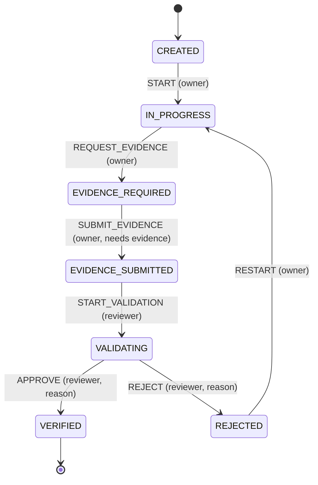

# Proof-of-Work OS

**An automata-based evidence verification system for developer skills.**

Live deployment: https://proof-of-work-os.onrender.com

## Problem

Skill lists and task trackers are self-reported: anyone can tick "Completed" or write "I know Flask". Recruiters cannot tell claim from proof.
Proof-of-Work OS makes a claim count only after it passes a **controlled verification lifecycle**: the developer attaches evidence, a *different* person reviews it, and every step is recorded in a tamper-evident log. The lifecycle is enforced by a finite-state machine, not by convention.

## Features

- Accounts with hashed passwords, CSRF protection, per-user data isolation
- Projects and tasks (create / view / edit / delete); every task gets one workflow
- **Finite-state machine** governing `CREATED → IN_PROGRESS → EVIDENCE_REQUIRED → EVIDENCE_SUBMITTED → VALIDATING → VERIFIED / REJECTED` (+ `RESTART` after rejection)
- Evidence submission (repo, commit, PR, deployment, demo, write-up, other link) with strict validation; evidence is locked once submitted
- Reviewer role: only a reviewer who does **not** own the task can start a review, approve or reject, and must give a written reason
- **Standout feature — tamper-evident audit trail + live automaton view** (below)
- Reviewer aid: transparent evidence *completeness* checklist (not automated verification)
- Safe, repeatable schema migrations that preserve existing data

## Standout feature: hash-chained audit trail replayed through the automaton

Every successful transition is appended to `state_transitions` with `hash = SHA-256(fields + prev_hash)`, so each entry commits to all earlier ones. On every task page the app **verifies the chain and replays the recorded events through the automaton**. History is accepted only if:

1. every hash and link matches (no edited, removed or reordered records),
2. every step is an edge of the transition table (the event word is accepted by the DFA),
3. the replayed end state equals the state stored on the workflow,
4. the evidence that was submitted still matches the digest sealed at submission time.

The page also draws the automaton as SVG from the real transition table: current state, transitions already taken, transitions you can fire now, and transitions waiting on another role. Refused actions (invalid transition, wrong role, failed guard) are logged and shown under *Blocked attempts*; a "Demo" panel lets you try a forbidden event on purpose.

**Limits (say this in interviews):** it is tamper-*evident*, not tamper-proof. Someone with full write access to the SQLite file can recompute the whole chain. Anchoring `chain_head` externally would close that gap. Updates are also blocked at DB level by triggers, but a DB admin can drop triggers.

## The automaton

Formally a DFA `M = (Q, Σ, δ, q0, F)`:

- **Q** = 7 states, **Σ** = 7 events (`automata/states.py`)
- **δ** = a *partial* transition function (`automata/transitions.py`); undefined (state, event) pairs are rejected
- **q0** = `CREATED`, **F** = `{VERIFIED}`; `VERIFIED` is terminal



Beyond δ, the engine checks, in order: event exists → δ defined → actor allowed (role read from DB; owner can never review own work) → guards (evidence present; decision reason ≥ 5 chars) → atomic write.

**Change from the earlier version:** `VERIFIED → RESTART` was removed so a verified proof cannot be silently re-opened.

## Architecture

| Path | Responsibility |
|---|---|
| `automata/` | Pure FSM: states, events, δ, role requirements. No DB/Flask |
| `services/automata_engine.py` | Transactional engine: checks, atomic state + history + side effects |
| `services/integrity.py` | Hash chain, evidence digest, chain verification/replay |
| `services/evidence_service.py` | Evidence validation, storage, completeness checklist |
| `services/fsm_view.py` | View-model for the SVG diagram (from real data) |
| `routes/` | Flask blueprints: auth, main/dashboard, tasks, projects |
| `database/` | `schema.sql` (original baseline), `migrations.py`, connection + `transaction()` |
| `templates/`, `static/` | Jinja UI |
| `tests/` | pytest suite |

Atomicity: each transition runs in `BEGIN IMMEDIATE`; state update is a compare-and-swap on the old state and count; the history insert, state update, verification records and task update commit together or roll back together.

## Database

Existing tables are kept. Migration 1 (tracked via `PRAGMA user_version`) adds: `users.role`; `workflow_instances.round/chain_head/transition_count`; chain columns on `state_transitions`; `evidence.workflow_id/round`; table `blocked_actions`; indexes (one workflow per task, unique `(workflow_id, seq)`); append-only triggers. Tasks lacking a workflow get one (replacing the old create-on-dashboard-load behaviour). Pre-existing transitions are sealed into the chain and marked `actor_role='legacy'`. Nothing is dropped or deleted.

Upgrade: just start the app or run `flask --app app init-db`. Safe to repeat. Back up your `.db` first as good practice.

`tasks.status` (Pending/Completed) is the owner's **self-reported** progress. The **workflow state** is the verified truth. Approval also sets status to Completed.

## Run locally

```bash
python -m venv venv && source venv/bin/activate   # Windows: venv\Scripts\activate
pip install -r requirements-dev.txt
export REVIEWER_EMAILS=reviewer@example.com        # optional; see below
python app.py                                       # http://127.0.0.1:5000
```

Demo with two accounts: sign up as a developer; sign up again (other browser/incognito) with the e-mail listed in `REVIEWER_EMAILS` to get reviewer powers. Or grant later: `flask --app app set-role someone@example.com reviewer`.

### Demo script (3 minutes)
1. Developer: create task → *Start work* → *Ready to provide proof* → add repo + write-up → *Submit*.
2. Open "Demo: try an action the automaton should refuse", attempt `APPROVE` → blocked and logged.
3. Reviewer: Review queue → *Begin review* → try to approve as the developer (refused) → approve/reject with reason.
4. Show the audit trail "Integrity verified". Then tamper (below) and reload: "TAMPERING DETECTED".

Tamper demo (sqlite3 shell on your local DB):
```sql
DROP TRIGGER state_transitions_no_update;
UPDATE state_transitions SET reason = 'edited' WHERE seq = 1;
```

## Configuration

| Variable | Purpose |
|---|---|
| `SECRET_KEY` | Session signing. **Required** when `POW_ENV=production` |
| `POW_ENV` | `production` enables Secure cookies and the SECRET_KEY check |
| `DATABASE_PATH` | SQLite file (default `database/pow_os.db`) |
| `REVIEWER_EMAILS` | Comma-separated e-mails granted the reviewer role at signup/login |
| `PORT` | Used by `python app.py` |

## Tests

```bash
python -m pytest -q
```
Tests use temporary databases and never touch `database/pow_os.db`. They cover transitions, invalid moves, role/guard enforcement, rollback, concurrency, tamper detection, evidence validation, auth/CSRF, user isolation, migrations, and an HTTP end-to-end flow.

## Deployment (Render)

`render.yaml` runs gunicorn with a generated `SECRET_KEY`. Set `REVIEWER_EMAILS` in the dashboard. **SQLite on Render's free plan is ephemeral** — data resets on deploy/restart. For persistence attach a paid disk and set `DATABASE_PATH` (see comments in `render.yaml`) or move to PostgreSQL (not implemented).

## Known limitations / future work

- Reviewers are designated by configuration; there is no admin UI or reviewer-assignment/reputation
- No automated checks of GitHub (repo exists, commit authorship); the completeness checklist is not verification
- Hash chain is not externally anchored; no login rate-limiting or password reset; no file uploads
- A public recruiter-facing profile of verified skills is not built; skills/`evidence_skills` tables exist but are unused
- No screenshots are bundled: run the app and capture your own

## Author
Tanu Luthra
